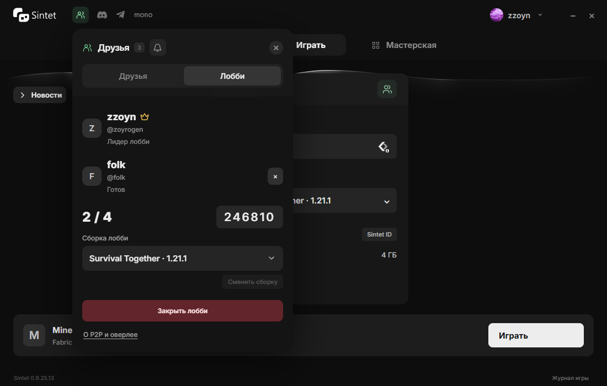
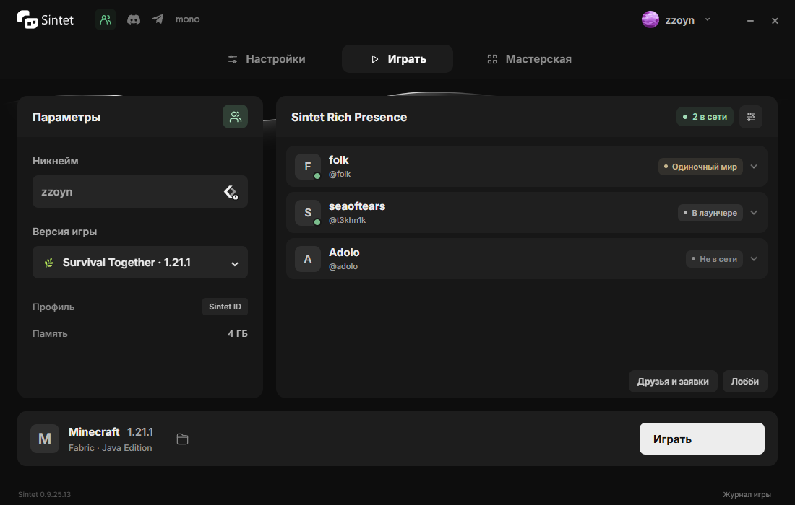
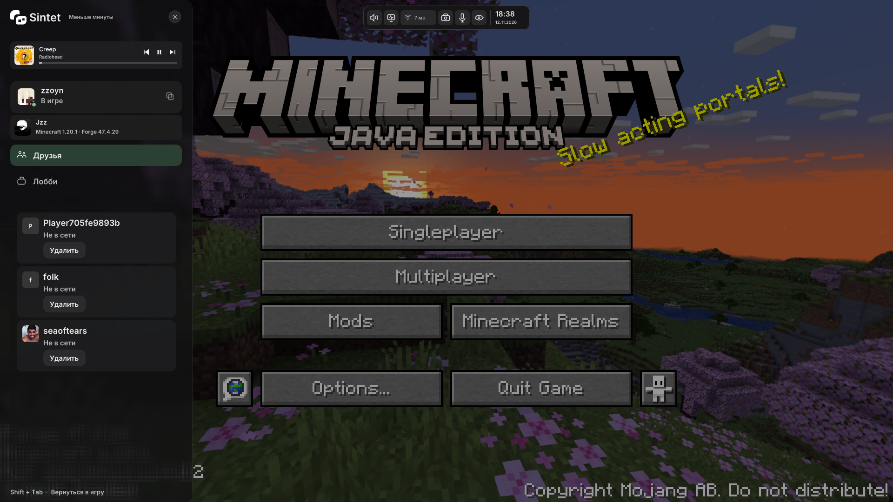
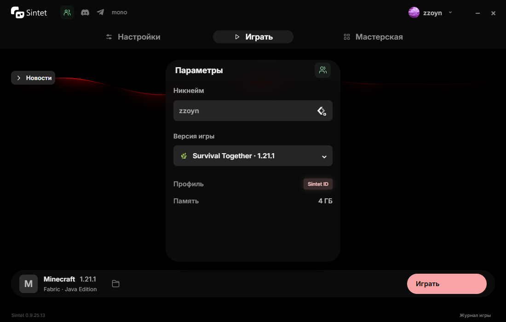
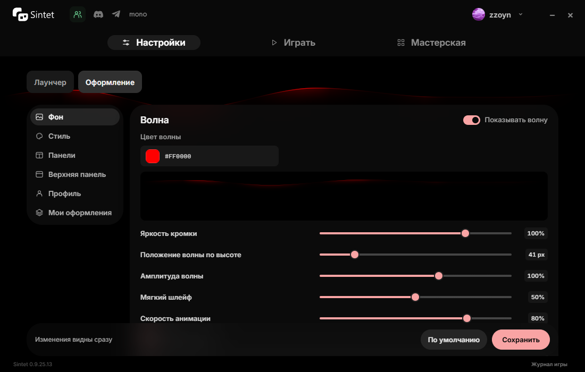

<p align="center">
  <picture>
    <source media="(prefers-color-scheme: dark)" srcset="frontend/assets/brand/sintet-light.svg">
    
  </picture>
</p>

<p align="center"><strong>Лаунчер Minecraft Java Edition для Windows 10 и 11</strong></p>

<p align="center">
  <a href="https://sintet.xyz/#download"><strong>Скачать установщик</strong></a> ·
  <a href="https://github.com/zzoyn522-sys/Sintet/releases">Стабильные выпуски</a> ·
  <a href="https://discord.gg/KURVdKAUAy">Discord</a> ·
  <a href="https://t.me/sinted_launcher">Telegram</a>
</p>

<p align="center">
  <a href="LICENSE"></a>
  
</p>


## Возможности

- Vanilla, Fabric, Forge и NeoForge. Лаунчер подбирает Java и проверяет файлы перед запуском.
- Отдельные сборки и мастерская. Ищи моды, шейдеры, ресурс-паки и сборки в каталогах. В «Моём» можно выделить несколько карточек правой кнопкой и управлять ими сразу.
- Друзья, лобби и оверлей в Minecraft. Видимость оверлея можно отключить в настройках.
- Оформления с собственными фонами, шрифтами и фильтрами. Настройки темы можно экспортировать в `.sldcfg`.

## Лобби, друзья и оверлей







## Мастерская и редактор оформления

<p align="center">
  
  
</p>

## Тема «санчез»

<p align="center">
  
  
  
  
</p>

Снимки лаунчера сделаны на демонстрационных данных.

## Предупреждение Windows SmartScreen

EXE лаунчера и установщика пока выпускаются без сертификата подписи кода Windows. SmartScreen может показать предупреждение при первом запуске. Скачивай файлы с сайта Sintet или из GitHub Releases и сверяй SHA-256 выпуска. [Как работает SmartScreen](https://learn.microsoft.com/en-us/windows/apps/package-and-deploy/smartscreen-reputation).

## Исходники и обновления

| Компонент | Где смотреть |
| --- | --- |
| Установка Minecraft, Java и загрузчиков | [`internal/launcher`](internal/launcher) |
| Мастерская и интерфейс | [`internal/workshop`](internal/workshop), [`frontend`](frontend) |
| Оверлей и игровой мост | [`native`](native), [`bridge`](bridge) |
| Проверка и установка обновлений | [`updater`](updater), [`updates.go`](updates.go) |

GitHub Releases хранит копии стабильных сборок. Установленный лаунчер получает обновления через [стабильный канал Sintet](https://sintet-updates.zzoyn522.workers.dev/stable/latest.json). Манифест подписан Ed25519 и содержит SHA-256 и размер EXE. Лаунчер проверяет их перед установкой. Для ручной проверки EXE на GitHub в выпуске приложена контрольная сумма.

При включённом оверлее лаунчер передаёт DLL JVM через `-agentpath`. Игровой мост подключается через `-javaagent`. [Подробнее об оверлее](native/README.md).

## Сборка из исходников

На Windows x64 нужны Go 1.24+, JDK 17+, Visual Studio 2022 Build Tools с компонентами C++ и Windows SDK. Для запуска нужен Microsoft WebView2 Runtime.

```powershell
$version = (Get-Content VERSION -Raw).Trim()
cmd.exe /d /c native\build.bat
powershell.exe -NoProfile -ExecutionPolicy Bypass -File bridge/build.ps1
powershell.exe -NoProfile -ExecutionPolicy Bypass -File updater/build.ps1 -Version $version
go build -trimpath -tags desktop,production -ldflags "-s -w -H windowsgui -X main.launcherVersion=$version" -o Sintet-launcher.exe .
```

Запусти собранный `Sintet-launcher.exe`.

После сборки можно выполнить `go test ./...`. Для проверки JavaScript нужен Node.js 22+: `node --test tests/*.test.* _checks/workshop-sources.test.mjs`. [Сборка установщика](installer/README.md) · [Формат оформлений](SLDCFG.md).

## Лицензия

Исходный код Sintet распространяется по [GNU GPL версии 3](LICENSE). Сторонние библиотеки и ресурсы сохраняют собственные условия. Лицензии библиотек находятся в [`native/vendor`](native/vendor), сведения об отдельных значках – в [`frontend/assets`](frontend/assets). Встроенный шрифт Inter распространяется по [SIL Open Font License 1.1](frontend/assets/fonts/OFL-Inter.txt).
